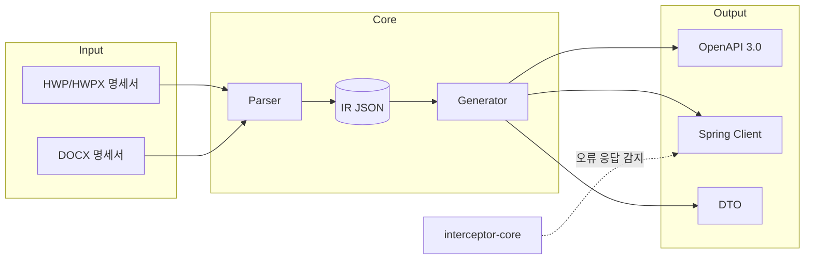

# H2Spec (HWP to Spring-Client)

[](https://github.com/junu0305/H2Spec/actions/workflows/build.yml)
[](./LICENSE)
[](#)
[](#)

H2Spec은 HWP, HWPX, DOCX 형식의 공공데이터 API 명세서를 읽어 다음 결과물을 생성합니다.

- OpenAPI 3.0 문서
- Spring `RestTemplate` 클라이언트
- 응답 DTO
- HTTP 200으로 반환되는 오류 응답을 감지하는 Interceptor

## 목차

- [주요 기능](#주요-기능)
- [구조](#구조)
- [빠른 시작](#빠른-시작)
  - [1. 설치](#1-설치)
  - [2. 명세서 변환](#2-명세서-변환)
  - [3. 생성 결과](#3-생성-결과)
  - [4. 프로젝트 설정](#4-프로젝트-설정)
  - [5. 클라이언트 호출](#5-클라이언트-호출)
- [지원하는 문서 형식](#지원하는-문서-형식)
- [변환 옵션](#변환-옵션)
- [LLM 파서](#llm-파서)
- [Interceptor만 사용하기](#interceptor만-사용하기)
  - [RestTemplate](#resttemplate)
  - [WebClient](#webclient)
  - [에러코드 사전](#에러코드-사전)
- [빌드](#빌드)
- [IR 계약](#ir-계약)
- [Git 컨벤션](#git-컨벤션)
  - [브랜치 구조](#브랜치-구조)
  - [커밋 메시지](#커밋-메시지)
- [기여 방법](#기여-방법)
- [라이선스](#라이선스)

## 주요 기능

- HWP, HWPX, DOCX 명세서를 중간 규격(IR) JSON으로 변환
- IR에서 OpenAPI 3.0 문서와 Spring 클라이언트 코드 생성
- 여러 명세 파일 일괄 변환
- `RestTemplate`과 `WebClient`의 오류 응답 감지 지원
- 규칙 기반 파서와 선택형 LLM 파서 제공

공공데이터 API 중에는 인증키 오류나 호출 한도 초과도 HTTP 200으로 반환하는 경우가 있습니다. H2Spec은 응답 본문의 `resultCode` 등을 확인해 이런 응답을 `PublicDataApiException`으로 처리합니다.

## 구조



### 모듈

| 모듈 | 역할 |
|---|---|
| `parser` | DOCX, HWP, HWPX 명세서를 IR JSON으로 변환 |
| `parser-llm` | LLM으로 명세서를 해석하고 규칙 기반 파서와 교차 검증 |
| `generator` | IR에서 OpenAPI 문서, Spring 클라이언트, DTO 생성 |
| `interceptor-core` | `RestTemplate`과 `WebClient`용 오류 응답 감지 기능 제공 |
| `cli` | 파서와 제너레이터를 실행하는 명령줄 인터페이스 |
| `llm-eval` | 파서 결과 평가 도구 |
| `web` (예정) | 파일 변환용 웹 UI |

## 빠른 시작

Java 17 이상이 필요합니다.

### 1. 설치

```bash
curl -sL -o h2spec.zip https://github.com/junu0305/H2Spec/releases/download/v0.1.0/h2spec-v0.1.0.zip
unzip h2spec.zip
```

### 2. 명세서 변환

```bash
./h2spec-v0.1.0/bin/h2spec convert \
    --input 기술문서.docx \
    --output generated \
    --package com.example.publicdata
```

HWP, HWPX, DOCX, IR JSON을 입력할 수 있습니다.

```bash
./h2spec convert --input 명세서.hwp --output generated
./h2spec convert --input 명세서.hwpx --output generated
./h2spec convert --input docs/schema-example.json --output generated
```

디렉터리를 입력하면 바로 아래의 명세 파일을 한 번에 변환합니다. 하위 디렉터리는 탐색하지 않습니다. 일부 파일이 실패해도 나머지 파일은 계속 처리하며, 실패가 하나라도 있으면 종료 코드는 1입니다.

### 3. 생성 결과

```text
generated/
├── ir/MsrstnList.json
├── openapi/MsrstnList.json
└── kr/go/h2spec/client/msrstnlist/
    ├── MsrstnListClient.java
    └── dto/MsrstnListResponse.java
```

IR은 파서와 제너레이터 사이의 계약입니다. 내용을 검수하거나 수정한 뒤 다시 입력할 수 있습니다.

### 4. 프로젝트 설정

```groovy
repositories {
    mavenCentral()
    maven { url 'https://jitpack.io' }
}

dependencies {
    implementation 'com.github.junu0305.H2Spec:interceptor-core:v0.1.0'

    // XML 응답을 사용할 때만 추가합니다.
    implementation 'com.fasterxml.jackson.dataformat:jackson-dataformat-xml:2.17.1'
}

sourceSets.main.java.srcDir 'generated'
```

### 5. 클라이언트 호출

```java
MsrstnListClient client = new MsrstnListClient(serviceKey);
MsrstnListResponse response = client.getMsrstnList(2L, 1L, null, null);
```

생성된 클라이언트에는 `PublicDataErrorInterceptor`가 적용됩니다. 응답 본문에 오류 코드가 있으면 `PublicDataApiException`을 발생시킵니다.

## 지원하는 문서 형식

공공데이터포털의 표준 기술문서 구조를 기준으로 파싱합니다. 다음과 같은 서식 차이도 처리합니다.

- 요청·응답 구간 제목과 필드명 표기의 차이
- 페이지가 나뉘거나 셀이 병합된 표
- 요청과 응답이 한 표에 들어간 형식
- 요청 예제나 서비스 URL에만 주소가 적힌 문서
- 응답 필드 표 없이 JSON 예제만 제공된 문서

문서에 직접 적혀 있지 않아 파서가 보완한 값은 IR의 `metadata.reviewNotes`에 기록합니다. 주소나 응답 필드를 확인할 수 없는 오퍼레이션은 건너뛰고 이유를 표준 오류로 출력합니다.

## 변환 옵션

| 옵션 | 설명 |
|---|---|
| `-i`, `--input` | 명세 파일 또는 명세 파일이 있는 디렉터리 |
| `-o`, `--output` | 출력 디렉터리. 기본값은 `./generated` |
| `--package` | 생성 코드의 기준 패키지 |
| `--format` | 응답 형식을 `xml` 또는 `json`으로 지정 |
| `--success-code` | 정상 응답으로 처리할 결과 코드 |
| `--engine` | `rule` 또는 `llm` 파서 선택 |

```bash
./h2spec convert \
    --input docs/sample \
    --output generated \
    --package com.example.publicdata \
    --format json
```

명령인자로 지정한 값은 생성에 사용되는 IR과 `reviewNotes`에도 반영됩니다. 기존 IR JSON을 입력한 경우 원본 파일은 수정하지 않습니다.

## LLM 파서

> LLM 파서 사용시 **문서 내용이 LLM 회사로 전송되고 사용자의 키로 과금됩니다.** 비공개 문서는 기본 엔진(`rule`)으로 변환하세요.

기본 파서는 규칙 기반 `rule` 엔진입니다. `--engine llm`을 지정하면 Claude, OpenAI, Gemini 중 하나를 사용해 문서를 파싱합니다.

```bash
export ANTHROPIC_API_KEY=...

./h2spec convert \
    --engine llm \
    --provider claude \
    --input 명세서.hwp \
    --output generated
```

LLM이 추출한 결과는 원문과 대조하고 규칙 기반 파서의 결과와 비교합니다. 주소와 성공 코드는 규칙 기반 파서와 같은 기준으로 결정합니다. 결과는 캐시되며, `--no-cache`로 캐시를 끌 수 있습니다.

| 옵션 | 설명 |
|---|---|
| `--provider` | `claude`, `openai`, `gemini` 중 하나 선택 |
| `--model` | 사용할 모델 ID |
| `--effort` | 추론 깊이 |
| `--no-cross-check` | 규칙 기반 파서와의 교차 검증 비활성화 |
| `--no-cache` | 결과 캐시 비활성화 |
| `--cache-dir` | 캐시 디렉터리 지정 |

API 키는 환경변수로만 받으며 출력, IR, 캐시에 저장하지 않습니다.

| 제공자 | 환경변수 |
|---|---|
| Claude | `ANTHROPIC_API_KEY` |
| OpenAI | `OPENAI_API_KEY` |
| Gemini | `GEMINI_API_KEY` 또는 `GOOGLE_API_KEY` |

LLM으로 만든 IR은 `reviewNotes`와 함께 검수한 뒤 저장소에 커밋하는 방식을 권장합니다. 빌드에서는 검수한 IR을 입력하면 외부 API 호출 없이 같은 코드를 생성할 수 있습니다.

| 실패 | 처리 |
|---|---|
| API 키·권한 오류, 잔액·사용 한도, 모델·추론 깊이·주소 오류 | 나머지 파일을 건너뛰고 중단 |
| 호출 한도·서버·네트워크 오류 | 재시도한 뒤에도 실패하면 해당 문서만 실패 |
| 응답이 대기 시간(Claude 10분, OpenAI·Gemini 30분) 동안 멈추거나 끊김 | 해당 문서만 실패 |
| 그 밖의 요청 오류 | 해당 문서만 실패 |


## Interceptor만 사용하기

### RestTemplate

```java
RestTemplate restTemplate = new RestTemplate(
    new BufferingClientHttpRequestFactory(new SimpleClientHttpRequestFactory())
);
restTemplate.getInterceptors().add(new PublicDataErrorInterceptor("00"));
```

Interceptor가 읽은 응답 본문을 메시지 컨버터에서도 다시 읽을 수 있도록 `BufferingClientHttpRequestFactory`를 사용해야 합니다.

기관이 다른 결과 코드 필드명을 사용한다면 후보를 추가할 수 있습니다.

```java
restTemplate.getInterceptors().add(
    new PublicDataErrorInterceptor("00", List.of("resultCd"))
);
```

숫자로만 된 결과 코드는 앞의 0을 제외하고 비교합니다. `00`, `0`, `000`, JSON 숫자 `0`은 같은 코드로 처리합니다. 문자열 코드는 원문 그대로 비교합니다.

### WebClient

```java
WebClient webClient = WebClient.builder()
    .filter(new PublicDataErrorFilter("00"))
    .build();
```

필터가 읽은 응답 본문은 이후 처리 단계에서 다시 읽을 수 있도록 복원됩니다.

### 에러코드 사전

알려진 결과 코드에는 의미와 조치 안내가 함께 표시됩니다. 새 코드는 [에러코드 등재 기준](./docs/error-codes.md)에 따라 추가할 수 있습니다.

## 빌드

```bash
./gradlew build
./gradlew test
```

JDK 17 이상이 필요합니다. 컴파일에는 Gradle toolchain으로 Java 17을 사용합니다.

로컬 Maven 저장소에 배포하려면 다음 명령을 실행합니다.

```bash
./gradlew publishToMavenLocal
```

## IR 계약

IR 구조는 `schema-example.json`에 정의되어 있습니다.

- `api.requestParameters[]`: 요청 파라미터의 타입, 필수 여부, 예시값
- `api.responseFields[]`: 응답 필드의 경로와 타입
- `api.errorSpec`: 성공 코드, 결과 코드 필드명, 알려진 오류 코드

IR 구조를 바꾸는 PR에는 `[BREAKING-IR]` 라벨을 붙이고 `parser`와 `generator` 담당자의 리뷰를 받아야 합니다.

## Git 컨벤션

### 브랜치 구조

모든 작업 브랜치는 `main`에서 분기하고, PR을 통해 다시 `main`으로 머지합니다.
브랜치 prefix는 **PascalCase**(앞글자 대문자)로 통일합니다.

```
main              ← 최종 병합 (PR 필수)
 ├── Feat/*       ← 새 기능
 ├── Fix/*        ← 버그 수정
 ├── Hotfix/*     ← 긴급 수정
 ├── Refactor/*   ← 리팩토링
 ├── Docs/*       ← 문서
 └── Chore/*      ← 빌드/설정
```

| 작업 종류 | 브랜치 이름 예시 |
|---|---|
| 새 기능 | `Feat/generator-dto`, `Feat/parser-docx` |
| 버그 수정 | `Fix/xml-parse-error` |
| 긴급 수정 | `Hotfix/build-error` |
| 리팩토링 | `Refactor/interceptor-core` |
| 문서 | `Docs/readme-update` |
| 빌드/설정 | `Chore/gradle-setup` |

### 커밋 메시지

커밋은 `타입: 내용` 형식의 소문자 prefix를 사용합니다 (Conventional Commits 스타일).

| 타입 | 용도 |
|---|---|
| `feat` | 새로운 기능 추가 |
| `fix` | 버그 수정 |
| `hotfix` | 긴급 수정 |
| `docs` | 문서 수정 |
| `style` | 코드 포맷팅 (기능 변경 없음) |
| `refactor` | 코드 리팩토링 |
| `test` | 테스트 코드 추가 |
| `chore` | 빌드/설정 변경 |

## 기여 방법

1. 이슈를 먼저 등록해 주세요 (`.github/ISSUE_TEMPLATE/issue-template.md` 사용)
2. 브랜치와 커밋 메시지는 위 [Git 컨벤션](#git-컨벤션)을 따릅니다
3. PR은 `.github/pull_request_template.md` 양식을 따릅니다 (PR 생성 시 자동 적용)
4. IR 스키마를 변경하는 PR은 parser/generator 양쪽 담당자 승인이 필요합니다

## 라이선스

[MIT License](./LICENSE)